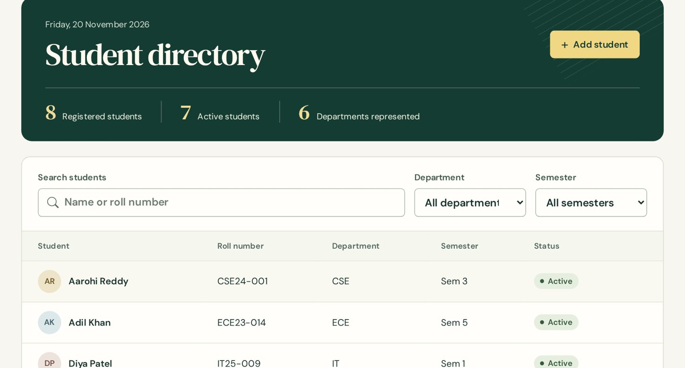
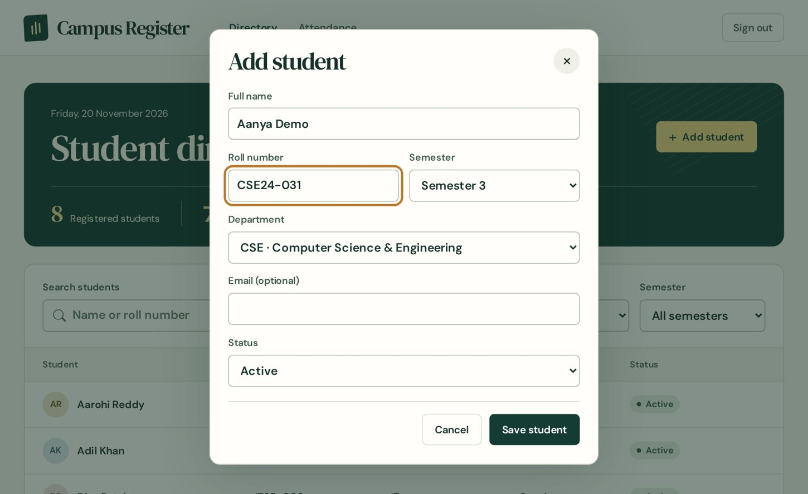
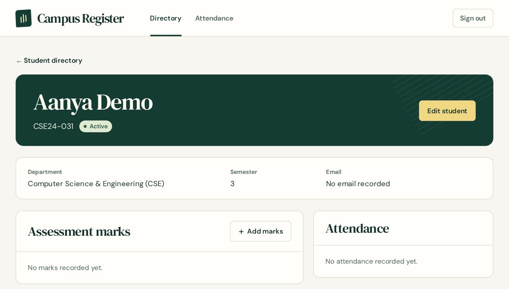
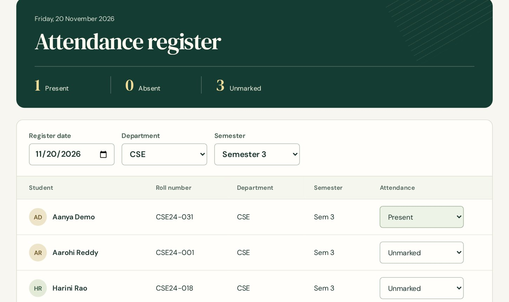
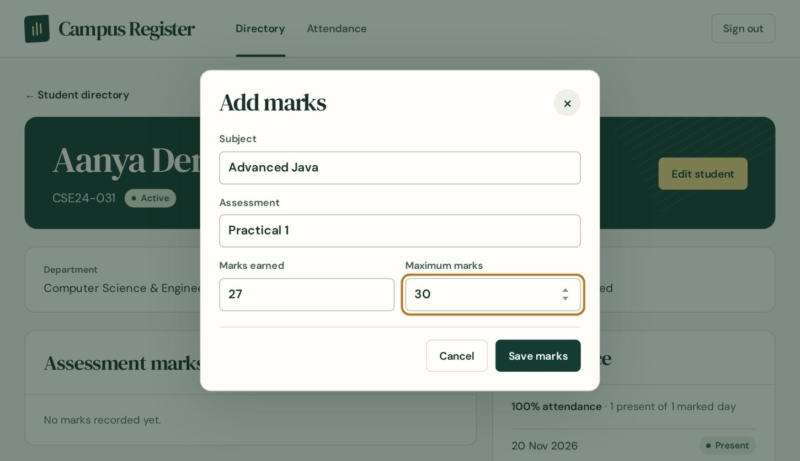

# Campus Register

A college student management project in Java. One computer runs the application and holds the H2 database. Staff use a browser on that computer, a phone, a tablet, or another laptop to manage the same records.

## First run

1. Extract the entire ZIP to a writable folder, such as Documents. Keep `campus-register.jar` and the `lib` folder together.
2. Install **Java 17 or newer** on the host computer. In Terminal or Command Prompt, run `java -version` to check it. A JDK also lets your team edit and rebuild the project. [Download a JDK for your operating system](https://adoptium.net/temurin/releases/?version=17)
3. On **Windows**, double-click `run.bat`. On **macOS or Linux**, open a terminal in the extracted folder and run `sh run.sh`. Alternatively, run `java -jar campus-register.jar` from that folder.
4. On that computer, open **http://localhost:8080**. Choose a staff password of at least 10 characters and confirm it. The project starts with six engineering departments and an empty student directory.
5. Click **Add student** for your own records, or **Load demo records** to try eight fictional students. The demo also includes one assessment score and attendance for the previous day. Demo loading is available when the directory is empty.

Keep the terminal open while using the app. Press **Ctrl+C** to stop it. After Java is installed, the bundled release runs offline. The release includes Tomcat, the H2 database engine and all runtime libraries.

## Open it on a phone or a teammate’s laptop

Connect both devices to the same trusted Wi-Fi or personal hotspot. On the second device, enter the **On the same Wi-Fi** address printed in the host terminal, for example `http://192.168.1.24:8080`. Use the address printed by your own laptop and enter the same staff password. Java is required only on the host.

If no address is printed, find the host’s Wi-Fi IPv4 address using `ipconfig` on Windows, the Wi-Fi network details on macOS, or `hostname -I` on Linux. Open `http://<that IPv4 address>:8080` on the second device. On Windows, allow Java on the private network when prompted. A campus guest network may isolate devices. A personal hotspot lets your team test the connection directly.

This release uses one shared staff login and HTTP for a local demonstration. An internet deployment with real student records would also need HTTPS and individual staff accounts with access permissions.

## Try a two-device demonstration

1. On the host, load the demo and open **Aarohi Reddy**. Her profile shows the department, semester, recorded marks and attendance.
2. Add another student with a unique roll number. Use their name or roll number in the directory search, or narrow the list by department and semester.
3. On the phone, open **Attendance**, choose a date and cohort, and set that student to **Present**. Open the profile on the laptop, or refresh it, to see the change. **Unmarked** clears that day’s entry. Attendance percentage uses marked days only.
4. In the profile, choose **Add marks**. Try `Advanced Java`, `Practical 1`, and `27` out of `30`. Use **Edit** beside the entry to change or remove it.
5. Restart the app and sign in again to show that the records were saved. Deleting a student requires confirmation and removes that student's linked marks and attendance.

## Database

The app runs `src/main/resources/db/schema.sql` on startup. The live database is `data/campus.mv.db` in the extracted folder when using the launchers. All devices connect to the same Java server. Starting another copy on another laptop creates an independent database.

| Table | Contents and relationship |
| --- | --- |
| `departments` | Department code and name. One department can have many students. |
| `students` | Unique roll number, full name, department, semester (1–8), optional email, enrolment status and an edit version. |
| `attendance` | One Present or Absent entry per student and date. The student ID and date form the primary key. |
| `marks` | Subject, assessment, marks earned and maximum for a student. The student, subject and assessment combination is unique. |
| `staff_account` | The salt and password hash for the single staff account. |

The app binds input to JDBC prepared statements. Foreign keys link each attendance entry and assessment to its student. A database constraint enforces `0 ≤ score ≤ maximum` and a positive maximum. When two users edit the same student or assessment, the edit version detects a stale save. Attendance writes compare the previously displayed state inside a transaction.

**Inspect the database for your viva.** Stop the app and open a terminal in the project folder. Run the included H2 SQL Shell.

```sh
java -cp lib/h2-2.5.252.jar org.h2.tools.Shell
```

At the `URL` prompt enter `jdbc:h2:file:./data/campus;IFEXISTS=TRUE;ACCESS_MODE_DATA=r`. Accept the suggested H2 driver, enter `sa` as the database user, and press Enter for the empty database password. The web staff password is separate. Try either read-only query.

```sql
SELECT s.roll_no, s.full_name, d.name AS department, s.semester
FROM students s
JOIN departments d ON d.code = s.department_code
ORDER BY s.full_name;

SELECT s.roll_no, m.subject, m.assessment, m.score, m.maximum
FROM marks m
JOIN students s ON s.id = m.student_id
ORDER BY s.roll_no, m.subject;
```

To back up, stop the app and copy the entire `data` folder. To use a backup, stop the app, set aside the current folder, put the backup at `data`, and start the app again. Keep this folder with the host team. Distribute the clean project ZIP when sharing code.

## Code and build

| Location | Responsibility |
| --- | --- |
| `src/main/java/college/register/Application.java` | Starts embedded Apache Tomcat and prints the addresses. |
| `ApiServlet.java`, `AssetsServlet.java` | Jakarta Servlet endpoints for JSON requests and browser assets. |
| `StudentRepository.java`, `AcademicRepository.java` | JDBC queries for profiles, class attendance and marks. |
| `Database.java`, `Accounts.java`, `Input.java` | Database setup, password handling and server-side validation. |
| `src/main/resources/web/` | Responsive HTML, CSS, JavaScript and locally bundled fonts. |
| `src/main/resources/db/` | Complete database schema and optional demo records. |
| `src/test/java/college/register/RegisterTest.java` | Regression tests for duplicate roll numbers, stale edits, attendance, persistence and deletion of related records. |

To edit in IntelliJ IDEA, Eclipse, or VS Code with Java support, open the extracted folder as a Maven project by selecting `pom.xml`. Choose JDK 17 or newer. Run `college.register.Application` with the project root as the working directory.

To rebuild from the terminal, install Maven 3.9+ and use a JDK. Run these commands from the project root. The first Maven build downloads dependencies.

```sh
mvn clean package
java -jar target/campus-register.jar
```

The Maven build runs the tests, writes the rebuilt app to `target/campus-register.jar`, and puts its runtime dependencies in `target/lib/`. Use that command to run your changed code. The top-level launchers start the prebuilt release.

## Setup help

| Symptom | What to do |
| --- | --- |
| `java` is missing or the class version is unsupported | Install a JDK 17 or newer, open a new terminal, and check `java -version`. |
| Port 8080 is busy | In PowerShell, run `$env:CAMPUS_PORT="8081"` and then `.\run.bat`. On macOS/Linux, run `CAMPUS_PORT=8081 sh run.sh`. Use the new port in both browsers. |
| The database is locked | Stop any other instance using the same data folder and close the H2 SQL Shell. |
| Staff password forgotten | Stop the app. In the project folder, run `java -jar campus-register.jar --reset-password` in an interactive terminal. Set a new password and restart. Existing students are kept. |
| You want a different database location | Set `CAMPUS_DATA_DIR` to a writable folder before starting the app. Use the same setting for password resets and restarts. |

## Bundled components

The `lib` folder contains unmodified Tomcat, H2, Gson and annotation JARs. Component notices and source links are under `licenses/`. The frontend includes DM Sans and DM Serif Text under the SIL Open Font License. Their license texts are in `src/main/resources/web/fonts/`.


## Task 4 - GitHub and hosted demonstration

This repository includes source code, a prebuilt Java 17 application, runtime libraries, the
H2 schema, tests, Dockerfile, and setup scripts. It does **not** contain real student records
or passwords. Never commit `data/` or `.env` files.

### Publish to GitHub

Create a GitHub repository named `campus-register-student-management` and push the entire
project folder (including its `Dockerfile`, `campus-register.jar`, and `lib/` folder).
From inside the project folder:

```sh
git init
git add .
git commit -m "Task 4 final Campus Register submission"
git branch -M main
git remote add origin https://github.com/sreesharan-dev/campus-register-student-management.git
git push -u origin main
```

The GitHub repository is published under `sreesharan-dev`.
You can alternatively upload files through GitHub's web interface. The GitHub repository
must contain the files *inside* the `Campus-Register` folder, not only the ZIP.

### Deploy as a Render web service (Docker)

1. Connect your GitHub repository in Render. Select **New > Web Service** and your repository.
2. Set Language/Runtime to **Docker**; Dockerfile path should be `./Dockerfile`.
3. Configure these environment variables in the Render dashboard (not on GitHub):

   | Key | Value |
   | --- | --- |
   | `CAMPUS_PUBLIC_MODE` | `true` |
   | `CAMPUS_ADMIN_PASSWORD` | Your private staff password, at least 10 characters |
   | `CAMPUS_DATA_DIR` | `/app/data` |
   | `PORT` | `10000` (or let Render assign one) |

4. Deploy the service. Set health check path to `/api/session`. On success, copy the HTTPS
   `onrender.com` URL shown for your service. Sign in using the environment password.
5. Open the link in a private/incognito browser and confirm the login page, student list,
   attendance, and marks operations. Add **fictional demo records only**.

**Storage warning:** The free Render web service has an ephemeral filesystem. Because H2 is
file-based, hosted records and the staff password hash may be lost when a free service
sleeps/restarts/redeploys; `CAMPUS_ADMIN_PASSWORD` recreates the staff login on restart.
This is suitable only for a disposable demo. Durable hosted data requires a paid persistent
disk mounted at `/app/data` or a database migration to persistent managed storage.
The local Windows deployment keeps its H2 file in `data/` across restarts.

**Public security boundary:** This is a demonstration application with one shared staff
account, not a production student records system. Use synthetic data, share credentials
only with authorized evaluators, and do not publish actual student information.

### Submission links to fill after publication

- GitHub: `https://github.com/sreesharan-dev/campus-register-student-management`
- Live demo: https://campus-register-student-management.onrender.com
- Final submitted ZIP: `92500119114_SreeSharan_SourceCode.zip`
- Final submitted report: `92500119114_SreeSharan_ProjectDocumentation.pdf`


## Application screenshots

Screenshots below were taken from the original Task 3 demonstration using fictional data.

**Student directory**



**Add student form**



**Student profile**



**Daily attendance**



**Assessment entry**


